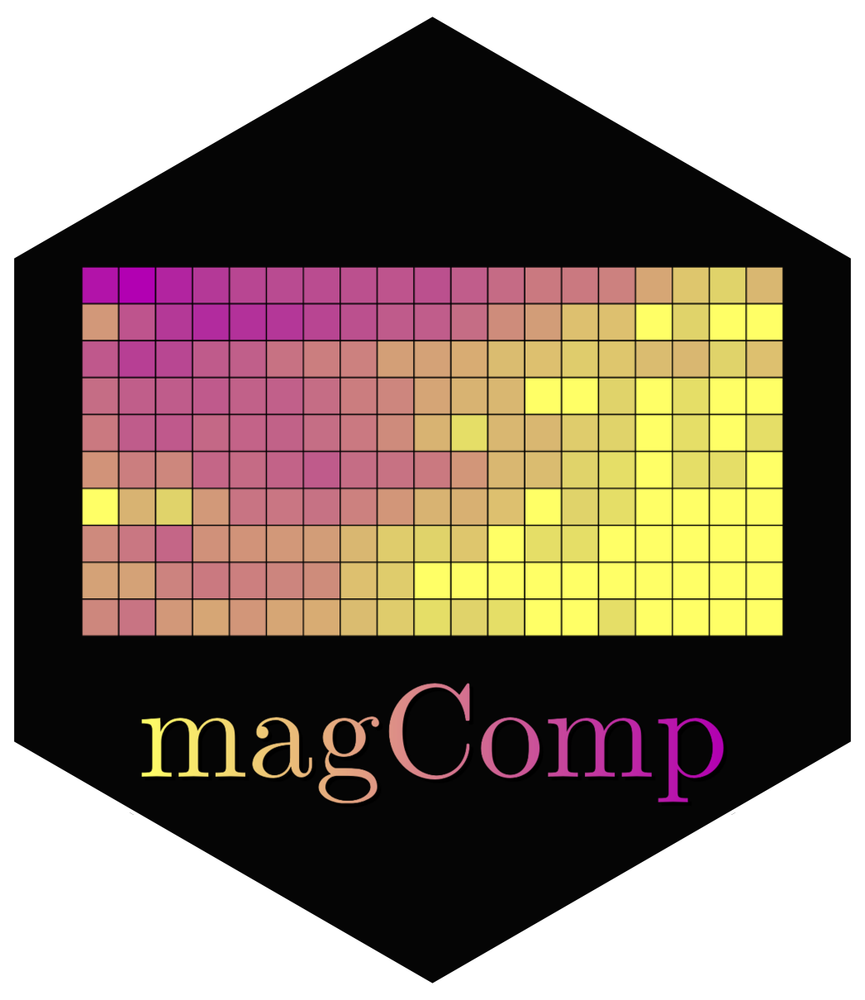

# magComp



`magComp` is an R package for Bayesian magnitude-composition models. It
models an overall abundance and how that abundance is distributed among
categories. A negative-binomial model describes total counts, and
multinomial models allocate those counts among categories. Users can specify
one categorical variable or two, with the second modeled conditionally on
the first. Magnitude and composition can be fitted together or separately.

The package was motivated by forest inventory and small-area estimation,
where sparse field plots and remotely sensed covariates support estimates
for individual stands and larger areas. Applications include estimating
tree density and its distribution among species and diameter at breast
height (DBH) classes, producing stand tables with associated uncertainty.
The framework is general: users choose their categories, covariates, and
conditioning order for other applications involving counts and composition.

**Work in progress.** The package and its supporting website, documentation,
and articles are under active development. We welcome feedback and
community contributions.

## Capabilities

- **Regression in each component.** Use different covariates for magnitude,
  category allocation, and conditional allocation within a parent category.
- **Group, spatial, and space-time effects.** Allow intercepts and slopes
  to vary among groups or across space and time. Spatial terms use Gaussian
  processes or nearest-neighbor Gaussian processes for larger datasets.
- **Structured composition.** Shared latent factors reduce the number of
  processes needed to describe dependence among categories. Smoothing priors
  relate regression coefficients across ordered classes.
- **Fitting and assessment.** Fit models with Markov chain Monte Carlo,
  inspect estimates and chain diagnostics with `summary()` and `plot()`,
  and extract posterior draws with `samples()`. Posterior predictive checks
  and cross-validation support model assessment and comparison.
- **Prediction and aggregation.** Predict counts, proportions, and densities
  at new locations. Use `standSummary()` to aggregate density draws to stands
  or other reporting areas, carrying uncertainty into the summaries.

Default priors and automatic starting values are provided; users can specify
their own through a common interface.

## Installation

Install the development version from GitHub:

```r
install.packages("remotes")
remotes::install_github("finleya/magComp")
```

Installation requires R 4.4.0 or newer and tools for compiling R packages
from source. After installation, start with `help("magComp-package")`.

## Documentation

The documentation is being prepared for the
[magComp website](https://finleya.github.io/magComp/), which brings together:

- [Worked articles](https://finleya.github.io/magComp/articles/index.html)
  with downloadable data and runnable code, progressing from individual
  model components to combined models with group, spatial, and space-time
  effects.
- [Function reference](https://finleya.github.io/magComp/reference/index.html)
  describing arguments, returned objects, and examples.
- [Modeling and software details](https://finleya.github.io/magComp/articles/modeling-and-software-details.html),
  including a technical PDF with model definitions, priors, sampler updates,
  and prediction methods.

Article sources and HTML previews are also available in
[`vignettes/articles/`](vignettes/articles/). See [NEWS.md](NEWS.md) for
release notes.

## Feedback and contributions

Questions, bug reports, and suggestions are welcome through
[GitHub issues](https://github.com/finleya/magComp/issues).
Contributions to the code, documentation, and worked examples are welcome
through [pull requests](https://github.com/finleya/magComp/pulls).
For bug reports, a small reproducible example and the package version help
us understand and address the problem.

See the [package contributors](https://finleya.github.io/magComp/authors.html)
for project credits.
